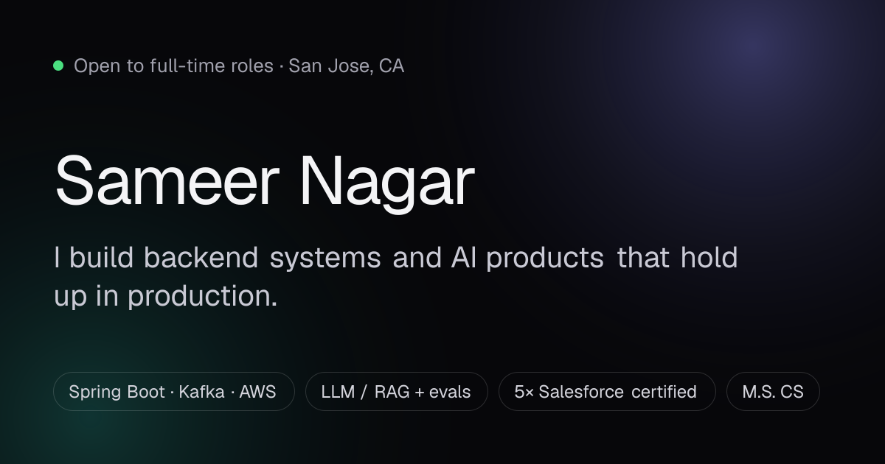

<div align="center">

# Genfolio

### A portfolio that can defend itself.

Every claim links to its evidence. Every skill shows where it was used.<br/>
And an AI you can interview, which only knows what's true.

[**Live site**](https://genfolio.onrender.com) · [Resume (PDF)](public/Sameer_Nagar_Resume.pdf) · [LinkedIn](https://www.linkedin.com/in/aavonsameer/) · [Email](mailto:nagarsam8989@gmail.com)

[](https://github.com/sameernagar-hub/genfolio/actions/workflows/ci.yml)


<a href="https://genfolio.onrender.com"></a>

</div>

---

## Hiring? Start here.

**Sameer Nagar**: software engineer who builds backend systems and AI products that hold up in production.

| | |
|---|---|
| 🟢 **Status** | Open to full-time roles · San Jose, CA · open to relocation and onsite |
| 🛠 **Now** | GenAI Lead & Full Stack Engineer, **Saayam For All**: 5 Spring Boot 3 microservices on AWS EKS with Kafka; owns the GenAI Lambda services and their CI/CD |
| 🏗 **Building in public** | [**REGEN**](https://github.com/sameernagar-hub/regen-engine): open-source job engine, v1.0.0, [live demo](https://regen-engine.onrender.com) |
| 📈 **Before** | Software Engineer, **Unthinkable Solutions**: 15+ production REST APIs · 99.9% uptime under SLA for 50+ enterprise clients · −40% manual effort |
| 🔬 **Research** | M.S. CS, CSUF (GPA 3.70). Thesis: **38× fewer false alarms** in anomaly detection (FPR 0.886 → 0.023) |
| 🏆 **Proof** | 2× first-place hackathons · 5× Salesforce certified · 2 peer-reviewed papers |
| 🪪 **Work authorization** | F-1 OPT (STEM extension eligible); will need sponsorship in the future |

**Three ways in:** [open the site](https://genfolio.onrender.com) → *Interview my AI* or *Match your JD* → [email](mailto:nagarsam8989@gmail.com).

## How I build

Five opinions, each backed by shipped work. The site renders them from [`src/content/principles.ts`](src/content/principles.ts), and the build fails if a proof link breaks.

| | Principle | Receipt |
|---|---|---|
| 01 | **Receipts over vibes.** If a system makes a claim, it points at the evidence. | [CLARITY](https://github.com/sameernagar-hub/clarity): every score cites evidence · [REGEN](https://github.com/sameernagar-hub/regen-engine): resumes only claim what's proven |
| 02 | **Evals before demos.** A demo shows it can work; an eval shows how often it doesn't. | [Anomaly Workbench](https://github.com/sameernagar-hub/anomaly-detection-workbench): FPR 0.886 → 0.023 · eval frameworks + guardrails at Saayam |
| 03 | **Fail loud, never silent.** Contracts and named errors turn outages into one-line fixes. | Contract tests after a silent cross-team production failure at Saayam |
| 04 | **Memory needs an undo button.** Agents ingest bad facts; provenance lets you revoke them. | [Immune](https://github.com/sameernagar-hub/immune): revocation cascade over agent memory |
| 05 | **Ship under pressure.** Constraints make the product sharper. | 1st place, Agentic Dev Tools Hackathon · Immune built in one day |

## Selected work

| Project | What it is | Proof | Links |
|---|---|---|---|
| **REGEN** | Job engine that discovers roles at the source, writes truthful resumes from a Fact Bank, applies with receipts. MCP-driven, zero model spend. | v1.0.0 · MIT · CI | [repo](https://github.com/sameernagar-hub/regen-engine) · [live](https://regen-engine.onrender.com) |
| **CLARITY** | FDA-style review room: retrieval → extraction → scoring, judgments only on cited evidence. | 53 tests | [repo](https://github.com/sameernagar-hub/clarity) · [live](https://fdaapproval-pzpr.onrender.com/?trial=NCT05951205) |
| **Immune** | An immune system for agent memory: quarantine a poisoned fact, revoke everything built on it. | MongoDB .local Build Fest | [repo](https://github.com/sameernagar-hub/immune) · [live](https://immune-two.vercel.app) |
| **AI Workflow Skill Builder** | Native macOS app that turns desktop activity into reusable automations. | 🏆 1st Place, Agentic Dev Tools | |
| **Anomaly Detection Workbench** | Drift-robust, argument-aware log anomaly detection (M.S. thesis). | FPR 0.886 → 0.023 | [repo](https://github.com/sameernagar-hub/anomaly-detection-workbench) |
| **PromptPilot** | Prompt intelligence from your real conversations. | v1 live | [repo](https://github.com/sameernagar-hub/promptPilot) · [live](https://promptpilot-web.vercel.app/) |

## What's on the site

- 🤖 **Interview my AI:** streaming assistant grounded in the content graph. Paste a job description and it lists matching skills with the role or project behind each. Runs on Gemini or Groq with automatic failover, and answers offline when no key is set.
- 🧾 **Skills with receipts:** hover a skill to see the exact role, project, paper, or certification that proves it, ranked by independent sources.
- ✨ **Motion-first, minimal text:** a scroll-lit About line, counting stats, a rotating headline, staggered headings, cards that tilt, thesis bars that grow. All of it falls back to static text with `prefers-reduced-motion`.
- 🧭 **Recruiter-first layout:** sticky identity column (status, location, work authorization, resume) and a live section index.
- 🚢 **Shipping log:** latest public GitHub pushes, refreshed hourly (ISR, no API call per visitor).
- ⌘ **Command menu**, dark/light theme, OG card, JSON-LD, sitemap, security headers.

## Architecture

```mermaid
flowchart LR
  subgraph content["src/content · distributed graph"]
    person & roles & projects & skills & principles & research & achievements & orgs
  end
  content --> graph["graph.ts<br/>validate ids · backlinks · AI context"]
  graph --> page["page.tsx<br/>server component, ISR 1h"]
  graph --> ai["lib/assistant.ts<br/>system prompt + offline answers + JD match"]
  ai --> chat["/api/chat<br/>Gemini ⇄ Groq failover → text stream<br/>rate limit · timeout"]
  gh["GitHub API"] --> page
  page --> ui["Sidebar · Principles · Projects · Experience<br/>SkillGraph · Research · Assistant · ⌘K"]
```

**Why it's built this way**

- **One graph, many files.** Roles, projects, skills, principles, and research point at each other by `id`. A highlight tagged `kafka` automatically becomes Kafka evidence on the page *and* in the AI's context. Nothing is typed twice.
- **The AI can't drift from the page.** Its system prompt is generated from the same graph the UI renders, with instructions to refuse anything not in it.
- **Guardrails, in layers.**
  - *Prompt rules:* answer only from the graph, never estimate salary or compare candidates, decline off-topic requests, never reveal instructions.
  - *Server-side leak guard:* the prompt carries a canary; the opening of every answer is held back and checked, and a leak is cut off before it reaches the browser.
  - *Failover:* Gemini ⇄ Groq, then offline answers from the graph (labelled as such), so the chat never shows an error page.
  - *Limits:* per-IP rate limit (8/min, 60/day), input caps, 20 s timeout, 6-hour answer cache for repeat questions to stay inside free-tier quotas.
  - *Honesty:* every chat carries a notice that answers are AI-generated and worth confirming with Sameer.
- **Keys stay server-side** in headers, never in URLs. No phone number on the page or in the AI's context.
- **Cheap to run.** One Render web service, `output: "standalone"`, static page with hourly revalidation.

```
src/
├─ content/      person · roles · projects · skills · principles · research · achievements · orgs · graph
├─ lib/          assistant · llm (Gemini, Groq) · rate-limit · github · site
├─ app/          page · layout · api/chat · api/health · opengraph-image · sitemap · robots
└─ components/   Sidebar · Principles · Projects · Experience · SkillGraph · Research
                 GitHubFeed · Assistant · CommandPalette · motion (primitives) · ui
```

## Run it

```bash
npm install
npm run dev          # http://localhost:3000
npm test             # graph integrity, assistant routing, JD matching, rate limiter
npm run typecheck
npm run build && npm start
```

Copy `.env.example` to `.env.local`. Every variable is optional.

| Variable | Purpose |
|---|---|
| `GEMINI_API_KEY` | Gemini key ([get one](https://aistudio.google.com/apikey)). Enables live, streamed answers. |
| `GROQ_API_KEY` | Groq key ([get one](https://console.groq.com/keys)). Second provider, or the first if `AI_PROVIDER=groq`. |
| `AI_PROVIDER` | `gemini` or `groq`: which answers first. The other takes over automatically if the first fails. |
| `GEMINI_MODEL` / `GROQ_MODEL` | Defaults: `gemini-2.5-flash` / `openai/gpt-oss-120b`. |
| `GITHUB_TOKEN` | Higher GitHub API limit for the shipping log (read-only, public data). |
| `NEXT_PUBLIC_SITE_URL` | Canonical URL for metadata and social cards. |

With no AI key, the assistant still works: it answers from the content graph offline. Check what's active at `/api/health`.

## Deploy on Render

1. Render dashboard → **New → Blueprint** → pick this repo. [`render.yaml`](render.yaml) defines the `genfolio` web service.
2. Paste `GEMINI_API_KEY` and/or `GROQ_API_KEY` when Render asks for secrets (both optional).
3. Every push to `main` redeploys; health check is `/api/health`.

The free plan sleeps when idle, so the first visit after a quiet spell takes a few seconds.

## Make it yours

Genfolio is MIT-licensed. Fork it, replace the files in `src/content/` with your own facts, and keep the rule that makes it work:
**every claim must point at something real.** `npm test` and `npm run build` fail on a broken reference.

---

<div align="center">

Designed and built by **Sameer Nagar** · MIT © 2026

</div>
